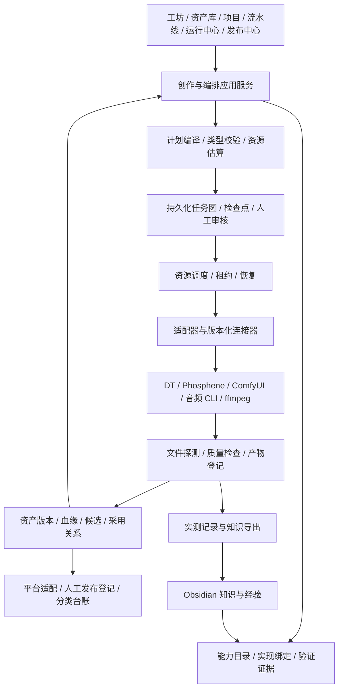

# 多模态资产 AI 生成控制中心：架构设计

日期：2026-10-29。状态：设计提案，已补充 MECE 审查约束；未实施、未迁移、未作发布验收。实施入口见 `docs/specs/multimodal-control-center-implementation.md`，审查见 `docs/reviews/2026-10-29-multimodal-design-mece.md`。

## 1. 产品目标与边界

将 Story Agent 演进为本地优先的一站式多模态资产生成与自动化流水线控制中心。用户既能单独生成、编辑、分析一个资产，也能把多个能力组合成可恢复的批量生产过程。短剧、MV、口播、广告是建立在同一底座上的创作模板。

统一管理创作意图、能力与模型、执行计划、运行资源、资产版本、人工采用、交付与平台发布记录。已有 Draw Things、Phosphene、ComfyUI、独立音频工具继续承担推理；控制中心负责跨工具编排和记录。

第一阶段保持模块化单体、FastAPI、SQLite WAL、现有 worker 与适配器。暂不引入微服务、消息队列、分布式调度和新的工作流基础设施。远程 worker 是后续扩展边界，不是当前实施前提。

## 2. 当前依据与验证边界

本设计读取了以下 Obsidian 笔记：

- `技能库/AI生成_模型与管线总表.md`（更新至 2026-10-29）
- `技能库/Story Agent 可选能力接入与实测记录.md`（正文含 2026-10-28 补充）
- `技能库/本机模型能力矩阵.md`（2026-10-20）
- `技能库/本地大模型部署与能力分布表.md`（2026-10-24）
- `技能库/音视频资产全景_MEDIA.md`、`技能库/音视频工具矩阵.md`
- `技能库/LTX-2.5 长场景分段出片（Phosphene One Shot）.md`

并对照本仓库的 `ARCHITECTURE.md`、`docs/HANDOFF.md`、连接器文档、模型配置及媒体/工坊/项目工作流源代码。桌面 `saspec.md` 作为 a2v 场景需求输入。

这些资料存在冲突：旧矩阵写 YuE2 未安装，后续接入记录已有真实产物；总表仍有 FLUX.2 下载中、已删除的 Pony/Illustrious 及旧 mflux 默认等历史条目。不能仅按笔记标题日期决定每条事实的新鲜度。

本轮没有启动推理、探测全部服务或重新校验权重；下面是基于记录的资源路由设计，不能作为当前服务在线和质量验收证明。

| 能力 | 主路径设计 | 显式备选或实验路径 | 证据与限制 |
|---|---|---|---|
| 通用图像生成 | Draw Things / FLUX.2 Klein 4B | Juggernaut SDXL；Krea2 风格配置 | DT FLUX.2 有系统任务实测；其他按各自配方验收 |
| 图像编辑与控制 | ComfyUI 已导入的多参考工作流 | FLUX 3、Krea2 专用图；InstantID | 新模型出图成功不代表多参考编辑已接通；InstantID 待复验 |
| t2v / i2v / 音画视频 | Phosphene / LTX-2.5 | h3.c / H3；DT / LTX-2.3；ComfyUI / LTX-2.5 | DT HTTP 实测返回无声帧数组；ComfyUI 新笔记记载带音轨出片，但未证明 Story Agent 接入 |
| a2v / 口型同步 | Phosphene / LTX-2.5 | LongCat 专用口播 | 现有提交入口，分段、音频绑定、项目生产闭环仍需补齐 |
| 歌曲与配乐 | ACE-Step 独立 API | Phosphene / YuE2 | YuE2 已有系统任务记录；不同风格和歌词遵循需人工评价 |
| 音效 | ComfyUI / Stable Audio 3 | 其他已验证工作流 | 现有记录指出 Pinokio 重装后的系统调用仍待复验 |
| 配音 / 换声 / 分离 / 转写 | CosyVoice3 / Seed-VC / Demucs / Whisper | 独立配方 | 复用现有适配器；把语言、音色、时间对齐分别验证 |
| 剪辑、混音、字幕、交付 | ffmpeg + 现有 compose/QC/export | FCPXML 往返 | 运行前核滤镜，产物记录实测尺寸、帧率、时长和音轨 |
| 文本规划、看图与检索 | Ollama 角色路由 + 向量检索 | 已配置的外部 LLM | 按角色配置和本机存量核验；旧笔记的模型 tag 不自动视为现存 |
| 专项待验 | IC-LoRA、InstantID、FastMetal | MRT2 恢复、训练工具 | 单独列实验区，验证前不加入默认自动选路 |

保持已决定的本机默认：DT 主出图、Phosphene 主视频、ComfyUI 按需、mflux 不作默认。重复能力可以保留质量/成本/控制上的差异；工具数量不作为能力覆盖率。

## 3. 总体分层

关键边界：项目管理“为什么做、采用哪个结果”；模板定义“怎么组合”；计划冻结“这次具体做什么”；调度器决定“何时能做”；适配器只与工具交互；台账负责“究竟做出了什么”。

## 4. 核心对象

| 对象 | 职责与关键约束 |
|---|---|
| Workspace / Project | Workspace 先对应现有本地数据域；Project 是可选的创作归属，独立工坊不强制建项目 |
| CreativeSpecVersion | 延续 append-only gen_specs；保存创作意图、输入引用、参数、种子和锁定状态 |
| CapabilityDefinition | 稳定能力 ID 与版本、具名输入输出端口、参数 schema、约束和文案 key；不内嵌某一工具地址 |
| ModelPackage | 模型架构、版本/摘要、量化、编码器/VAE/LoRA 依赖及兼容性；模型文件不等于可调用服务 |
| RuntimeInstance | 工具实例、版本、所在主机、配置引用、运行状态和资源占用；密钥仅引用密钥存储 |
| CapabilityBinding | 把某能力连接到模型包、适配器、工具实例和版本化配方；同一能力可以有多个实现 |
| ValidationEvidence | 验证的绑定版本、时间、任务与资产、测试参数、实际指标、人工评价及有效性 |
| PipelineTemplateVersion | 可复用的节点/端口/边、默认策略和子流程；发布后版本不可变 |
| ExecutionPlan | 模板、输入、绑定、模型/配置版本和策略的冻结快照，提交前可审阅与估算 |
| PipelineRun / NodeRun / Attempt | 一次任务图、一个逻辑节点及其执行尝试；可恢复、可取消、失败可局部重试 |
| AssetVersion / Representation | 延续资产台账；原始产物不可变，预览、代理、缩略图、转码作为派生表示 |
| AssetRelation / AssetSelection | 血缘记录输入、派生、分离、裁切、锚点关系；采用记录具体项目对象与槽位选择的版本 |
| TimelineVersion / ClipPlacement | 编辑决定：资产、源区间、目标区间、轨道、增益与速度；与渲染请求分离 |
| QCReport / ReviewDecision | 机器检查和人工采用分别记录，不将技术完成当作创作验收通过 |
| PublicationTarget / PublicationRecord / PublicationItem | 发布目标平台与账号、一次发布及有序素材清单；绑定具体资产版本，支持一稿多平台和一个帖子含多资产 |

对象关系：SpecVersion → ExecutionPlan → Run → NodeRun → Attempt → media_job → AssetVersion；AssetSelection 与 TimelineVersion 引用具体 AssetVersion。独立工坊允许不经项目 Spec 直接创建冻结计划。

不要一次性重建所有表。先沿用 gen_specs/media_jobs/media_assets/workflow_runs，增加图、绑定、关系和采用记录；新对象与旧对象一一建立明确关联，不双写两套运行状态。

## 5. 能力、模式、工具与配方

能力目录描述用户意图，例如 image.generate、image.edit、video.generate、video.lipsync、audio.tts、audio.music、audio.separate、audio.convert、text.asr、compose.assemble、analyze.qc。沿用现有 kind 标识，逐步以注册表承载细分能力，避免新增工具就增加一套业务分支。

t2v、i2v、a2v 是可见的生成模式，不能仅根据 refs 文件后缀暗中推导。video.generate 提供 t2v/i2v 输入配置，video.lipsync 提供 a2v 配置；界面用统一模式选择器呈现。音画同生、静音、使用原始音频、混合生成声作为独立声音策略。

端口使用角色和类型：`portrait: image`、`source_audio: audio`、`conditioning_vocals: audio`、`start_frame: image`、`clip: video`、`transcript: text+timecodes`。文件扩展名仅用于导入探测，不能承担角色识别。

兼容性按实际边界校验：模型架构与 LoRA、编码器与 VAE、推理后端与精度、端口类型与时序约束。跨图像模型的普通图片引用不因 family 不同而拒绝；a2v 也不必与项目默认视频模型同 family。只有共享 latent/权重等确需兼容的边才强制家族绑定。

将现有 Pipeline Plan 的“整套推荐模型”解释为 ProductionProfile（默认路由/风格/交付建议），与真正的 PipelineTemplate 任务图区分。项目可选择默认档案，每个节点仍可显式绑定其他兼容实现，变更时展示影响范围。

新实现默认 disabled/experimental，经证据验证后才进入自动选择池。选择池先检查硬约束，再按质量、耗时、内存、成本偏好排序；计划中解释选择依据。已启动任务固定绑定，失败不能静默换引擎或把 a2v 降为 i2v。

### 5.1 完整的模态转换与操作矩阵

缩写中 t=text、i=image、a=audio、v=video；本节 a2a 指音频转换。Agent-to-Agent 是另一种通信协议概念，未来若接入应归连接器/代理协作层。

转换方向用于界面发现和输入输出匹配，不能独自充当业务能力 ID。同为 a2a 的换声、降噪、分离、续写有不同输入约束和质量标准；每项必须绑定具体 operation、端口 schema 和验证证据。

| 方向 | 具体操作 | 现有资源或接入路径 | 规划边界 |
|---|---|---|---|
| t2t | 故事、脚本、改写、结构化规划、翻译 | 已配置 LLM 角色与 agent specs | 复用角色路由；自由文本与结构化 JSON 输出分别验证 |
| t2i | 文生图、人物设定、场景、海报 | DT / FLUX.2、SDXL、Krea2；ComfyUI 专项 | 区分底模/风格/精度与实际可用绑定 |
| i2i / i+t2i | 图像编辑、多参考合成、局部重绘、风格转换；超分作为独立增强操作 | DT 单参考能力、ComfyUI 编辑工作流 | 已有接口不代表每种操作均支持；mask、多参考、控制图分别声明 |
| t2a | 配音、歌曲、器乐、音效 | CosyVoice3、ACE-Step、YuE2、Stable Audio 3 | 语音/音乐/音效分别作为 capability；歌词、提示词、韵律各有端口 |
| a2a | 说话/歌声换声、声部分离、降噪、响度处理；音频编辑/续写 | Seed-VC、Demucs、现有 audio.enhance、ffmpeg；生成式编辑/续写逐项核验 | 换声需参考音色；分离为一对多输出；剪切/变速与生成式操作分开 |
| a2t | 转写、字幕、时间码；摘要与翻译 | Whisper + 后续文本节点 | 转写不等于精确强制对齐；歌声识别与字幕对齐独立验收 |
| i2t | 看图描述、提示词反推、图像质量与身份检查；OCR | 已配置视觉模型、既有 QC/分析工具；专项识别绑定待核验 | 普通 caption、OCR、身份分数不是同一种证据 |
| t2v | 提示词生成视频，可选原生音画 | Phosphene / LTX-2.5；其他兼容绑定 | 不强制生成关键帧；是否支持原生音轨是输出契约 |
| i2v / i+t2v | 图生视频、首尾帧、参考图控制 | Phosphene、H3、DT / LTX-2.3 | 首尾帧、多参考、IC-LoRA 是专项约束，不能自动推导支持 |
| a+i(+t)2v | 对口型、口播、唱歌视频 | Phosphene a2v；LongCat 备选 | 界面简称 a2v；明确要求的人物图、驱动音频和听觉音轨 |
| v2v / v+t2v | 视频增强、补帧、重定时、延展、局部重做、视频编辑 | ffmpeg、Phosphene 专项；ComfyUI 可导入模板 | 编码转码与生成式编辑分开；模型级操作必须有独立绑定与实测 |
| v2a | 提取音轨；按画面生成音效/配音 | ffmpeg 提取；视频理解 → 音频节点可形成复合模板 | 提取不等于生成；原生视频条件音频生成待验证，不能标成现成能力 |
| v2i | 抽帧、末帧/闭口锚点、关键帧选取 | ffmpeg、Phosphene 锚点接口、后续分析 | 保存来源帧/时间戳，区别机器选择和人工选择 |
| v2t | 视频描述、分镜反推、质检报告、字幕 | 抽帧视觉分析 + ASR + 文本汇总 | 标明抽帧覆盖、音轨来源和置信边界，不宣传未经验证的原生视频理解 |
| 多输入 → 成片 | 图片/视频/音频/字幕 → 剪辑、混音、字幕、交付包 | 现有 compose、ffmpeg、QC、export | 时间轴版本与生成规格分开，严格校验缺失输入及声音策略 |
| 数据集 → 模型资产 | 角色 LoRA/音色适配训练、评估、登记 | 现有训练适配器、Phosphene 训练入口 | 生成模型包及评估资产；适配器支持不等于训练已实测 |

面向用户同时提供“按目标”与“按转换方向”筛选：例如音频 → 换声/分离/降噪/配乐/音效，图片 → 生成/编辑/增强/理解。高级用户可按 a2a/i2i 筛选，但操作表单始终使用准确的能力名称。

节点输入输出采用可扩展类型与语义约束，不限定单输入单输出，也不要求所有模态方向都有一个可用模型。尚无验证绑定的操作显示“待接入/待验证”，不得由 LLM 临时拼接后宣称等价支持。

### 5.1.1 生成式音乐 a2a：ACE-Step 与 YuE2

2026-10-29 读取本机源码确认，a2a 同时覆盖音乐再生成，不能只列换声/降噪：

- ACE-Step：本机 `acestep/constants.py` 将 Turbo 的任务列为 text2music/repaint/cover；Base 另列 extract/lego/complete。cover 是音乐风格迁移/改编，不等于精确音色克隆；repaint 支持区间重绘。模型变体必须声明各自任务集合，不能把 Base 的完整能力套到 Turbo。
- Phosphene / YuE2：本机代码支持 `music_source_audio`、`music_cover_task` 的音频来源翻作路径；转录/cover 需要主音乐包之外的可选模型。另有 take/sound/restyle 变体依赖父歌曲保留的乐谱或生成工件，不能假设任意上传歌曲都能调用同一种变体。
- Story Agent 现有 ACE-Step 适配器只把第一条普通 refs 写成 reference_audio_path，未完整映射 src_audio_path、重绘区间和控制参数；YuE2 `_music_form` 当前也未透传上述 source/cover/variation 字段。因此源码支持与控制中心已接通分开登记。
- 增加 `audio.music.cover`、`audio.music.repaint`、`audio.music.complete`、`audio.music.variation` 等细分能力定义；稳定 ID 在实施时确定。端口明确 source_audio、style_reference、lyrics、score、parent_artifacts，分别验证语义保留、旋律保留、时间范围和产物可用性。
- 本轮仅核对代码，没有运行音乐 a2a、核实 YuE2 cover 模型安装完整性或作听感验收；不得标记为已实测。

### 5.2 首批复合模板

- 配音口播：文本 → t2a → a+i2v → 字幕与交付。
- 歌曲换声 MV：t2a 或导入歌曲 → a2a 分离 → a2a 换声 → 与伴奏混音；换声后人声驱动 a2v，与 t2v/i2v 镜头合成 MV。
- 参考图宣传片：i2t 分析 → 人工确认描述 → t2t 脚本 → i2i 场景/构图编辑 → i2v；t2a 配音/音乐 → 成片。
- 视频再创作：v2i 抽帧 + v2a 提取音轨 → a2t 字幕与 i2t 画面分析 → 人工确认 → i2i/i2v 或已验证 v2v → 新配音/混音与交付。
- 系列资产生产：t2t 批量规划 → t2i 候选 → 审核采用 → i2i 修订 → 导出资产包；无需绑定短剧项目。

这些模板只使用已启用的具体操作绑定；一个环节待验时，预演计划即显示阻塞，不把复合能力当成一键已可用。

## 6. 一套任务图，三个入口

- 工坊：单节点、预设或小模板运行，生成候选资产。可以将资产采用到项目，也可以把参数保存为模板。
- 项目：短剧/MV/口播等领域规划器把镜头、音轨、人物需求编译成同一种 ExecutionPlan；项目页只负责创作语义和选用结果。
- 自动化：批量、事件触发和定时请求使用同一提交服务。第一版先支持手工批量与完成事件，后续再增加调度入口。

三者共享权限、输入解析、绑定、调度、任务、产物与审计。项目工作流不直接调用网页工坊接口，也不重复实现推理逻辑。现有故事阶段继续负责文字规划，produce/compose 逐步改为图计划的提交与汇总。

最小任务图能力：具名多输入/多输出、fan-out/fan-in、map 批量、条件跳过、人工审核、受限重试。a2v 的后续锚点必须等待实际产物，采用持久化子流程逐段展开；展开记录具有幂等键和段数上限，不能依赖页面内存循环。第一版无需任意循环与通用脚本节点。

工坊当前只支持 @prev、media_jobs.depends_on 单前驱；新增 node_dependencies / node_input_bindings 来表达多个依赖及输出槽。保留旧字段只作为旧链兼容入口，图运行使用统一依赖解析器。

## 7. a2v 作为首个完整样板

说话：文本 → TTS（可跳过，直接用录音）→ 音频探测 → 片段规划 → a2v 子流程 → 装配。

唱歌：歌曲生成或导入 → Demucs 分离一次 → 原曲/人声共同时间轴 → 镜头切片 → a2v 子流程；叙事镜头可以同时采用 t2v/i2v → 全片装配。

每段保存 source_audio_asset/version、source_in/out、timeline_in/out、驱动 stem、人物/关键帧、模式、锚点来源与时间、渲染帧数、保留区间。预裁切音频的偏移归零，整曲输入则传源偏移，避免偏移被应用两次。

分段时长默认上限 5 秒是初始策略，不是所有引擎的全局常量。Phosphene 的闭口锚点可用 `/a2v/continue_song` 取得；下一段起点以锚点真实时间为准，重叠裁切写入编辑计划。找不到锚点时采用显式策略：人工挑帧，或允许普通切点且标记质量风险。

原曲 audio 和 conditioning stem 分开传递：模型听人声，观众听原曲。优先使用现有 audio.separate，将共享 stem 资产通过具名引用传入 Phosphene `audio_stem`；自动分离仅作为显式配方，不能重复分离每个镜头或静默退回混音驱动。

片段为独立产物槽，装配后才更新镜头主产物。父任务汇总片段进度，失败只重跑受影响片段及其依赖后继；锚点改变会使后继 stale，其他独立镜头保留。

MV 时间轴由音频驱动：使用探测到的曲长与帧/采样时基，字幕不挤长镜头，a2v 不用任意慢放补时长。严格成片模式缺镜或文件丢失就拒绝装配，返回镜头/片段列表。普通预览可显式允许静帧占位，并显示缺项。

旁白、对白、歌词显示与是否发声分别设置；MV 模板默认旁白不发声。既阻止新建禁用 TTS，也在计划中排除旧的非活动规格；不删除旧版本和资产。

## 8. 资源调度与运行可靠性

本机 128GB 统一内存是共享资源，不能用“每个工具各自串行”代替整机调度。延续单个重推理任务的保守默认，对接外部工具手工启动的负载。

资源模型包括：主机可用内存、压力/swap、任务峰值预算、模型常驻、外部活动渲染、同一 runtime 的并发额度，以及 CPU/IO 密集任务配额。GPU/Metal 占用用可取得的指标和引擎活动状态描述，不能把进程 RSS 当成完整统一内存占用。

提交前展示资源快照；调度领取前再次检查、原子预留；检查不满足进入 waiting_resource 并给出具体原因。任务书中的“已有 20GB+ 渲染就不开始”实现为可配置的外部活动渲染规则，不能简单阻断所有 RSS 超阈值的空闲进程。资源探测缺失时显示 unknown，按本机显式策略处理。

ffmpeg 装配通常不占推理 GPU，但有 CPU/IO/内存开销，仍受配额限制。调度按依赖、优先级、预计资源和模型切换成本安排；不能为减少模型切换无限饿死其他任务。

执行状态与验收状态分开：节点 pending/ready/running/waiting_resource/waiting_review/succeeded/failed/cancelled/skipped；资产技术有效与人工 accepted/rejected 独立。界面将这些状态映射为 locale key。

重启恢复：冻结配置版本；持久化 external_id；重新附着前核对远端任务。外部 API 不支持幂等且提交响应丢失时进入 reconciliation_required，不能盲目重发。取消向后继传播，只尝试终止本次拥有且适配器可安全取消的远端任务；不调用会中断其他用户任务的全局 interrupt。

长流程交给 worker；不依赖终端前台等待维持任务存活。使用租约、心跳和检查点，复用现有 restart drain 的在途依赖策略。

## 9. 资产与知识的治理

资产分别记录 media_type（image/audio/video/text/model）、operation/capability、语义角色和来源。逐步消除 upload.image 与 image.generate 前缀承担格式判断造成的差异。

分离、裁切、换声、抽帧、转码、合成均登记关系边及参数；原文件不可变。模型产物与人工采用分离，current 槽位只作兼容投影，避免不同任务自动覆盖已采用结果。

派生缓存键包括输入内容摘要、节点类型/版本、实际绑定/模型/连接器版本、全部有效参数、种子和时基。纯预处理可默认复用，创意采样按“复用/新候选”明确选择。上游变更只标记依赖后继过期，不删除历史产物。

删除历史记录、回收资产、物理清理是三个操作；物理清理先列出引用，已被采用或运行任务引用的文件不可直接删除。受限资产的权限和分级沿关系传播，缓存命中也必须重新校验访问权限。

Obsidian 负责经验、配方说明和有日期的证据；运行数据库负责实际状态，文件探测负责存量事实。知识导入只生成待核实条目，Markdown 内的命令不自动执行。导出记录任务、绑定、参数、硬件、实测与人工评价，禁止导出密钥。

## 10. 用户界面与 API 边界

主导航建议：总览、工坊、资产库、项目、流水线、运行中心、发布中心、资源与模型、知识与设置。

- 工坊按图像、视频、声音、文本/分析、后期组织能力；显示主力/备选/实验、需要的输入、验证级别与资源。
- 资产库支持搜索、预览、版本、血缘、采用位置、用作输入和回收；人声/伴奏/锚点等中间资产可折叠展示。
- 流水线第一版用步骤列表与依赖详情编辑，模板可预览任务图；先证明可用，再做自由拖拽画布。
- 运行中心显示父流程/子节点、等待原因、租约、外部任务、预计/实际成本、局部重试和审核；总览计数与钻取共用查询口径。
- 资源与模型分开显示安装、服务在线、接口接通、真实生成、人工质量评价，各自有时间与版本，不能合并为一个绿色“可用”。

建议的新增服务边界：CapabilityCatalog、BindingResolver、PlanCompiler、GraphExecutor、ResourceScheduler、AssetGraph、ReviewService。保持现有 Ledger/Adapter/SpecStore 边界，先内部服务后 API。

候选 API 资源：capabilities、bindings、pipeline-templates/versions、execution-plans、pipeline-runs/nodes、asset-relations、asset-selections、timeline-versions。最终接口在实施时按现有鉴权、审计、统一错误信封和 OpenAPI 流程确定；错误码稳定、前端双语从第一天接入。

连接器导入流程：读取 schema/模板 → 校验端口与依赖 → 预演计划 → 隔离冒烟 → 登记证据 → 启用。导入 API 工作流不代表已安装模型；安装应用不代表兼容；升级引擎需重新评估受影响绑定的证据。连接器使用配置 URL/路径和密钥引用，禁止任意未审阅 shell 执行。

## 11. 发布中心与分类台账

发布是资产生产闭环中的独立领域。导出文件、复制文案、打开平台页面都不代表已发布；第一版支持人工发布与人工登记，自动平台连接器以后按需增加。

### 11.1 对象与归类

- Platform：可扩展的平台目录及平台特有字段 schema，平台 ID 不写死在页面或枚举分支。
- PublicationTarget：平台 + 账号标识 + 可选频道/栏目；账号记录显示名、平台账号 ID/主页和负责人，第一版不要求保存平台登录凭据。栏目是可选层，不假设每个平台都有。
- PublicationRecord：一次帖子/视频/音频发布，记录目标、标题、正文、标签、内容类型、主题分类、所属项目/系列/集、计划与实际发布时间、执行方式、登记人、平台帖子 ID/URL、备注及证据。
- PublicationItem：发布记录与具体资产版本的多对多关系，含顺序、角色（主视频/轮播图/封面/音轨/字幕/附件）与平台适配版本。引用具体资产 ID、内容摘要及实际发布元数据快照，不能只存可变 current 或路径。
- PublicationEvent / Attempt：发布、失败、编辑、替换、撤回、删除、恢复及登记纠错的历史事件；每次尝试与发布记录的当前状态分开，保留原始事实。
- 可选 PublicationMetricSnapshot：以后人工或连接器录入播放/互动等快照，注明来源、采集时间和统计口径；本期不依赖平台抓取实现。

分类维度分别管理：平台/账号/栏目是发布目的地；作品类型（视频/图文/歌曲等）、主题、用途、项目/系列/集是内容分类；草稿/待发布/已发布等是状态。三个维度不能混成一个标签字段。标签补充检索，可扩展分类表支持重命名与停用，既有记录保持可追溯。

### 11.2 人工闭环与状态语义

基本流程：选择已采用的资产版本 → 选平台与账号 → 确认平台适配文件、封面与文案 → 建立待发布记录 → 人工在外部平台发布 → 回填链接/帖子 ID、实际时间与素材确认 → 记录人工发布成功。

记录生命周期建议 draft / ready / scheduled / published / withdrawn / deleted / cancelled；执行尝试另记 pending / in_progress / succeeded / failed。scheduled 仅表示计划时间，不承诺系统会自动发帖；自动发布是单独 execution_mode 和连接器能力。

published 需要人工确认或平台返回明确成功证据。URL/帖子 ID 能取得时应保存；平台无链接或暂缺时允许提供人工说明与证据附件，显示人工声明且未外部核验。删除和撤回不物理删除台账；平台当前可见性与当时成功发布的历史事实分别保留。

同一资产可发布到多个平台、账号或重复发布，默认不全局禁止。相同平台/账号/外部帖子 ID 防重复登记；无外部 ID 时提示疑似重复，用户可确认确为再次发布。请求重试采用幂等键；重复发布与重复 HTTP 请求的幂等语义分开。

发布后修改资产生成新版本并使相关适配文件过期，但不改变既有发布记录。帖子素材替换时记录新 Revision/Event 与新素材清单，保留原版本；封面和文案修改也留历史。归档/回收资产时提示已有发布引用，物理清理不能破坏发布溯源。

### 11.3 界面与编排耦合

发布中心支持按平台、账号、栏目、内容分类、项目、资产、时间和状态筛选；可切列表/计划视图。资产详情显示“发布到哪里、哪个版本、什么时间、链接和当前状态”，项目显示跨平台发布清单。

一条 PublicationRecord 计为一条发布，一条记录可含多资产；面板同时区分帖子数、唯一资产版本数和目标平台数，筛选与钻取共用口径。一次失败尝试不增加已发布数量，撤回/删除状态单独可查。

流水线可接“平台适配 → 准备发布包 → 等待人工发布登记”节点。等待人工时释放推理资源并持久化检查点；人工确认后才完成该节点。允许生产流程先完成，发布作为关联的独立流程运行，避免一条未发布帖子阻塞后续资产生成。发布节点也可复用已有素材，无须重生成。

自动发布后续沿用同一台账，增加连接器与授权，不把账号运营字段塞进推理适配器。平台权限、素材访问权限与发布登记权限分别校验；人工也须检查资产版本访问权。用户未授权时系统不得实际向外发布。本期仅设计和记录能力。

## 12. 渐进实施与验收

| 阶段 | 范围 | 完成标准 |
|---|---|---|
| P0 事实基线 | 核本机资源，区分已有修改；登记绑定与验证证据；明确模式/端口/时间语义 | 同一资源冲突可追溯；默认不变；计划能解释选择及阻塞原因 |
| P1 最小统一运行底座 | 具名端口、多依赖、冻结计划、节点映射 job、检查点；单节点工坊试接 | 一个资产生成任务从工坊和项目入口走同一执行服务；重启不丢节点且不重复提交 |
| P2 a2v 纵向闭环 | 分离共享、音频切片、动态锚点、子片段、严格装配；t2v/i2v 同时纳入模式路由 | 一段录音与一段歌曲各跑通；混合三种模式；失败局部恢复；人工口型评价与实测时长 |
| P3 资产、模板与人工发布 | 版本/血缘/采用、模板列表编辑、批量 map、审核点、估算、发布分类台账 | 工坊结果可采用到项目；项目单镜重做不重跑整片；旧结果可回溯；同一资产多平台及一个帖子多资产可登记并反查 |
| P4 自动化与能力扩展 | 事件/定时触发、完成通知渠道、导出、更多专项绑定 | 事件去重、次数/预算上限、暂停与取消可恢复；专项能力经实测再启用 |

P1/P2 以一个最小 a2v 纵向切片共同迭代，避免先造完整平台数周却无真实产物。先迁移单节点工坊和指定试点项目，旧项目继续旧路径；通过后再扩大到 produce/compose。每次数据库迁移前做一致性备份，保留旧表与资产；新图执行通过开关启用。配置升级的回退与图版本降级需要分别设计，不能仅回滚二进制。

重点验收：多输入与输出角色不串、共享 stem 只生成一次、fan-in 等齐、缺失资产明确报错、同输入新候选可生成、提交响应丢失不重发、取消不影响外部任务、资源不足不派发、锚点改变只影响后继、上传和生成资产预览一致、权限/分级不因缓存穿透、三模式项目合成不重复混音和口型变速。发布验收涵盖具体版本绑定、一对多/多对一发布、重复登记幂等、人工确认语义、素材替换历史、撤回保留、分类筛选/计数一致及越权访问拒绝。

架构设计不依赖补下载新模型。先复用现有资源验证平台缺口；FastMetal/IC-LoRA 等按具体新增能力和证据单独排期。若进入版本基线或发布候选，必须另跑 software-system-review 及全量门禁；本设计不代表代码交付或 release-ready。

## 13. MECE 审查后冻结的实施约束

### 13.1 注册表与类型契约

转换方向只是索引。执行操作使用稳定 capability ID + schema_version，映射 legacy kind 交给适配层；新增细分能力不要求修改全部 MediaKind 消费端。命名采用 output-domain.operation，例如 audio.music.cover；legacy kind 保持 audio.music，specific capability 单独持久化。旧任务没有该字段时使用明确的兼容映射。

CapabilityDefinition 的必需字段：id、schema_version、label_key、description_key、inputs、outputs、params_schema、constraints。端口声明 name、media_type、semantic_role、required、cardinality、timebase（适用时）。输出必须能定位到实际资产槽，禁止从产物顺序猜 main。

CapabilityBinding 必需字段：id/version、capability_id/schema_version、legacy_kind、provider、runtime_ref、model_ref、connector/template_digest、input/output_mapping、effective_constraints、resource_profile、verification_policy、enabled。模型/模板/配置摘要固定到计划，密钥只保留引用并在调用时授权解析。

已有泛型 ComfyUI 连接器作为执行实现复用。每张 API 工作流作为绑定版本登记，具名映射图像/音频/视频输入和多输出。增加 v2v、a2v 等输入支持须验证节点兼容，不能仅扩充界面下拉项；复合图只暴露已支持的内部进度，未支持的内部局部重试明确显示整体重跑。

### 13.2 图、状态、事务与事件

静态模板为 DAG：校验节点唯一、边端点存在、无环、输入完整、类型/数量兼容。条件跳过必须声明输出是否可选；required 上游失败/无输出则后继 blocked，不能误报 skipped/succeeded。fan-in 按明确集合等齐；动态展开具有唯一 expansion_key、单调序号、节点/尝试/时长/输出体积上限，并保证每次音频源区间前进。

NodeRun 生命周期：pending / ready / running / waiting_review / succeeded / failed / blocked / cancelled / skipped。waiting_resource 是 ready 的等待原因，reconciliation_required 是阻塞原因；两者不新增另一套执行终态。Run 聚合状态 queued / running / waiting / succeeded / failed / cancelled；关键节点失败或 blocked 时不能聚合成功。可选节点失败仅在计划明确允许时产生 completed-with-warnings 的结果标志。

GraphExecutor 不直接调用 Adapter；唯一执行入口仍是 media worker。GraphExecutor 在短事务内原子创建 node→job 关联、依赖和待投递事件；耗时 I/O 在事务外。数据库唯一约束保护 node attempt 的 job 创建、动态展开与消费事件去重。media_jobs 是推理执行状态权威，node 保持逻辑状态及其投影，恢复时从 job 对账；一个节点不得由旧 produce 与新图重复派发。

人工等待、远端对账和资源等待不占 workflow 执行线程或 GPU 预留。通过持久化状态再次唤醒，不维持 Python wait 循环。采用 SQLite outbox + 消费去重实现本地至少一次事件处理；生产者事务回滚不得留下可消费事件。外部提交不保证 exactly-once，不确定提交结果必须对账/人工认领，禁止自动重复调用。

重试新建 Attempt 并保留历史；带新种子的重做新建计划/候选。人工审核针对具体 plan/node/asset 版本和乐观锁 revision，输入已变化时拒绝旧审核。取消后晚到结果登记为未采用产物，不自动采用、不复活流程。

### 13.3 采用、缓存、时间与发布一致性

资产文件及原始生成 provenance 不变；AssetSelection 为采用权威，以 owner_type/owner_id/slot 唯一并通过 revision 做并发更新。项目逐步从 selection 读取，旧 is_current 只作同事务兼容投影；迁移前后不得让新旧页面分别决定采用结果。旧数据按既有 current 回填，每条映射可追溯，冲突列出人工处理。

结构化文本、图像、音频、视频、模型分别使用适合的验证器；ffprobe 不作为所有模态的通用完成条件。媒体资产保留实测属性，文本校验编码/schema，模型校验 manifest/摘要与必要依赖，不以文件非空代替验收。

时序字段采用半开区间 [in,out)，视频帧时间与音频采样率使用整数及有理数时基，界面显示秒值不作为累计精度来源。分离/换声后实测校验长度和起始偏移；121 帧/24fps 的容器时长与 120 帧间隔不同，不能用 (frames-1)/fps 冒充实测时长。裁切、重叠和末段补齐均写入 TimelineVersion，禁止默默慢放。

全局文件内容去重不授予资产访问权；缓存必须先检验用户对所有输入与输出的访问权和分级，不能返回另一受限对象的路径/摘要。缓存可命中不等于跨项目自动采用。

PublicationRecord 属于一个具体目标；多个目标为多个记录。PublicationRevision 及其 Item 清单不可变，记录指针指向当前修订；修改已发布内容增加事件和修订，不覆盖旧清单。actual_published_at 与 registered_at 分开，时间存 UTC 并保留展示时区。无链接的人工确认记录 confidence=manual_unverified，后补链接保留纠错事件。平台/账号/非空 external_post_id 唯一；空 external ID 不互相冲突。

### 13.4 权限、运营与验收范围

沿用现有 auth role 的 read/write/admin 与内容分级，第一版不另造租户系统。reader 仅查看有权资产/计划/发布记录；writer 可创建运行、采用、审核和人工发布登记，但每次都验证具体输入对象的访问权；admin 管理运行实例、绑定、连接器、平台目录和物理清理。关闭 auth 时保留既有本机语义，不能借新入口绕过内容限制。全部变更记 actor、对象版本、时间和 trace_id；原始令牌不落日志。

默认不自动下载、不自动启动服务、不对外发布。资源探测失败的本机重推理暂停派发并显示原因；可按管理员显式配置放行。没有可用证据的绑定保持 experimental/disabled，不在默认自动路由中出现。外部进程的观测与平台自身的预留分开，控制中心不能保证外部手工任务遵守预留。

第一版交付目标为 P0–P3 及现有完成事件的基础去重设施；P4 的定时、自动平台发布、通知渠道、未安装模型和全部实验工作流另行扩展。覆盖转换方向不要求给每个方向下载一个模型，但已登记能力必须显示真实状态、可说明阻塞，已启用的绑定必须有实际可执行路径。

“一次交给实施者”指一个完整任务包内部连续完成分段提交与验收，不等于一个巨大提交或承诺一次生成即零缺陷。设计通过不替代实现后的独立审查、真实模型验证与人工质量验收。
